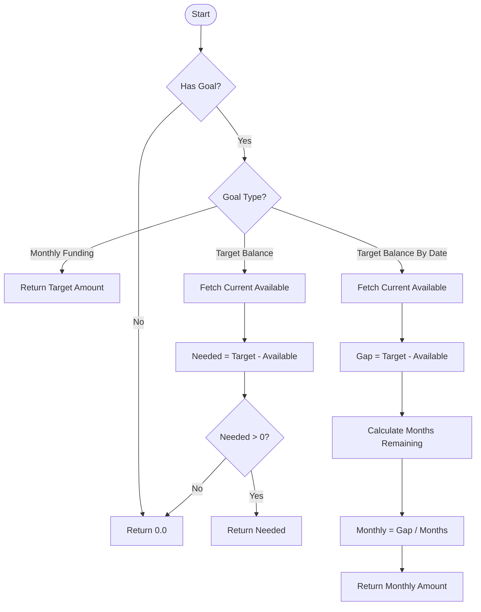

# Budgeting Algorithms

## To Be Budgeted (TBB) Calculation

```mermaid
flowchart TD
    Start([Start]) --> FetchIncome[Fetch Total Income (All Time)]
    Start --> FetchBudgeted[Fetch Total Budgeted (All Time)]

    subgraph Income Calculation
        FetchIncome --> FilterPos[Filter: Amount > 0]
        FilterPos --> FilterNoCat[Filter: Category is NULL]
        FilterNoCat --> SumIncome[Sum Amounts]
    end

    subgraph Budgeted Calculation
        FetchBudgeted --> SumBudgeted[Sum 'Budgeted' Column]
    end

    SumIncome --> CalcResult[TBB = Income - Budgeted]
    SumBudgeted --> CalcResult
    CalcResult --> End([End])
```

## Category Available Calculation

```mermaid
flowchart TD
    Start([Start]) --> FetchActivity[Fetch Total Activity (All Time)]
    Start --> FetchCatBudgeted[Fetch Total Budgeted for Category (All Time)]

    subgraph Activity Calculation
        FetchActivity --> FilterCat[Filter: Category ID Match]
        FilterCat --> SumTrans[Sum Transaction Amounts]
    end

    subgraph Budgeted Calculation
        FetchCatBudgeted --> FilterCatBud[Filter: Category ID Match]
        FilterCatBud --> SumBud[Sum 'Budgeted' Amounts]
    end

    SumTrans --> CalcResult[Available = Budgeted + Activity]
    SumBud --> CalcResult
    CalcResult --> End([End])
```

## Goal Target Calculation


